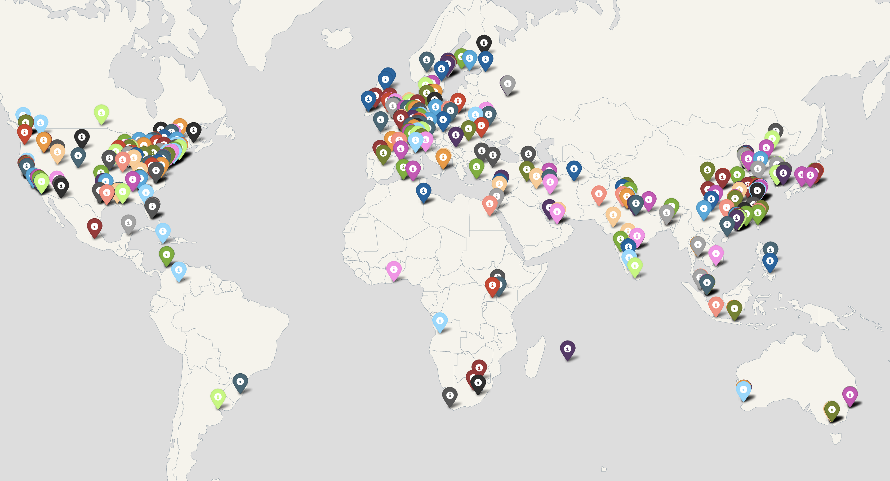

<h1 align="center">
&#127759; <code>CitationMap</code>: Google Scholar Citation World Map
</h1>

<p align="center">
<strong>CitationMap: A Python Tool to Identify and Visualize Your Google Scholar Citations Around the World</strong> [<a href="https://openreview.net/pdf?id=BqJgCgl1IA">PDF</a>]
</p>

<p align="center">English | <a href="README.zh.md">中文</a></p>

<div align="center">

[](https://openreview.net/pdf?id=BqJgCgl1IA)
[](https://www.techrxiv.org/users/809001/articles/1213717-citationmap-a-python-tool-to-identify-and-visualize-your-google-scholar-citations-around-the-world)
[](https://twitter.com/ChenLiu_1996)
[](https://www.linkedin.com/in/chenliu1996/)
[](https://scholar.google.com/citations?user=3rDjnykAAAAJ&sortby=pubdate)
<br>
[](https://pypi.org/project/citation-map/)
[](https://pepy.tech/projects/citation-map)
[](https://pypistats.org/packages/citation-map)
[![CC BY-NC-SA 4.0][cc-by-nc-sa-shield]][cc-by-nc-sa]
[![CC BY-NC-SA 4.0][cc-by-nc-sa-image]][cc-by-nc-sa]

[cc-by-nc-sa]: http://creativecommons.org/licenses/by-nc-sa/4.0/
[cc-by-nc-sa-image]: https://licensebuttons.net/l/by-nc-sa/4.0/88x31.png
[cc-by-nc-sa-shield]: https://img.shields.io/badge/License-CC%20BY--NC--SA%204.0-lightgrey.svg

</div>

<br>

&#127942; The **world's first free tool** to visualize your Google Scholar citations on a world map.

&#11088; There is **NO NEED to clone or fork** this repo unless you want to make custom changes.

&#128640; It only takes **1 line to install** and **4 lines to run**!

&#127760; A properly installed Chrome browser is required to run this successfully, since CAPTCHA checks will be redirected to a pop-up Chrome browser.

&#128073; Due to personal reasons, I am no longer able to run `CitationMap` for you if you run into problems. Apologies.

<br>

I am [Chen Liu](https://chenliu-1996.github.io/), a Computer Science PhD Candidate at Yale University.

## [New!] Desktop App Version
I have just made my first attemp to release an Desktop App for <code>CitationMap</code>. 

- [MacOS version for MacBook with Apple Silicon chip](https://github.com/ChenLiu-1996/CitationMap/releases/download/App-Desktop-MacOS/CitationMap-macOS-arm64.zip).


## Purpose
This is a simple Python tool to generate an HTML citation world map from your [Google Scholar ID](https://scholar.google.com/citations?user=3rDjnykAAAAJ).

It is easy to install (available on [PyPI](https://pypi.org/project/citation-map/)) and easy to use (see the [User Guide](https://github.com/ChenLiu-1996/CitationMap?tab=readme-ov-file#user-guide)).

## Minimalistic User Guide
This is for users familiar with python. Otherwise, please read the [User Guide](https://github.com/ChenLiu-1996/CitationMap?tab=readme-ov-file#user-guide).

**Long story short: DO NOT CLONE OR FORK if you just want to use it! Just installing and running in a single pythin script is enough!** Otherwise it will only make things complicated unless you know what you are doing.
### &#128640; 1 line to install.
```
pip install citation-map
```
If you want to install the latest version, run `pip install citation-map --upgrade`.

### &#128640; 4 lines to run.

Please copy and paste this to an empty `.py` file (name it something like `run.py`), replace my scholar ID with yours, and run it using `python run.py`.
```python3
from citation_map import generate_citation_map

if __name__ == '__main__':
    scholar_id = '3rDjnykAAAAJ'  # This is my Google Scholar ID. Replace this with your ID.
    generate_citation_map(scholar_id)
```

Chrome now starts in a separate temporary profile, and CitationMap connects to that window. When a CAPTCHA is detected, select **Continue to Google Scholar** on the explanation tab to return to the existing challenge. The explanation appears once per verification session. Your personal Chrome profile is not used.

**Important: keep the pop-up Chrome window open until the program finishes.** CitationMap uses this shared browser to let you solve Google Scholar CAPTCHA challenges manually. When a CAPTCHA appears:

1. Switch to the pop-up Chrome window and complete the CAPTCHA.
2. **Leave that browser window open. Do not close it after solving the CAPTCHA.**
3. CitationMap checks verification automatically and resumes once Scholar content is available. No Enter key or resume button is needed.

Repeat these steps if another CAPTCHA appears.


## Example Outcome
You will be given an **HTML file** as the output of the script.

If you open it on a browser, you will see your own version of the following citation world map.

Open the HTML file in your browser with an internet connection. You can zoom and pan, hover over countries to see their names, and click pins to see citing authors and affiliations.



Besides, there will be a **CSV file** recording citation information (citing author, citing paper, cited paper, affiliation, detailed location).

**Disclaimer:** It is reasonable for this tool to make some minor mistakes: missing a few citing authors, dropping a couple of pins in wrong locations, etc. If you care a lot about ensuring all citing authors' affiliations are included and accurately marked, you could try manually annotating on [Google My Maps](https://www.google.com/maps/d/) instead. This tool is meant to help people who cannot tolerate this painful process, especailly when they have a decent number of citations.

**NOTE:** **Now you can trade off between affiliation precision and recall** with the `affiliation_conservative` option. If set to True, we will use the Google Scholar verified official organization name from the citing authors. This is a very conservative approach, since (1) the author needs to self-report it in the affiliation panel, (2) the author needs to verify with the matching email address, and (3) the organization needs to be recorded by Google Scholar. For example, Meta (the company) is not in the list. Many thanks to [Zhijian Liu](https://github.com/zhijian-liu) for the [helpful discussion](https://github.com/ChenLiu-1996/CitationMap/issues/8).

## Citation
BibTeX
```
@article{citationmap,
  title={CitationMap: A Python Tool to Identify and Visualize Your Google Scholar Citations Around the World},
  author={Liu, Chen},
  journal={Authorea Preprints},
  year={2024},
  publisher={Authorea}
}
```
MLA
```
Liu, Chen. "CitationMap: A Python Tool to Identify and Visualize Your Google Scholar Citations Around the World." Authorea Preprints (2024).
```
APA
```
Liu, C. (2024). CitationMap: A Python Tool to Identify and Visualize Your Google Scholar Citations Around the World. Authorea Preprints.
```
Chicago
```
Liu, Chen. "CitationMap: A Python Tool to Identify and Visualize Your Google Scholar Citations Around the World." Authorea Preprints (2024).
```

## News

[Nov 5, 2026] Version 6.0 update >>> Reworked Google Scholar fetching with concurrent HTTP affiliation lookups and one shared browser for manual CAPTCHA solving. Added resumable affiliation lookups, cached geocoding with fewer requests and working Ctrl+C interruption, and an embedded Natural Earth world map that avoids blocked tile images. Improved citation pagination and handling of empty results. See the [Changelog](#changelog) for details.

[Oct 14, 2025] Version 5.0 released >>> Better handling of CAPTCHA.

[Aug 2, 2024] Version 4.0 released >>> Logic update. A new input argument `affiliation_conservative`. If set to True, we will use **a very conservative approach to identify affiliations** which leads to **much higher precision and lower recall**. Many thanks to [Zhijian Liu](https://github.com/zhijian-liu) for the [helpful discussion](https://github.com/ChenLiu-1996/CitationMap/issues/8).

[Jul 28, 2024] Version 3.10 released >>> Logic update. Tested on a professor's profile **with 10,000 citations**!

[Jul 27, 2024] Version 2.0 released >>> 10x speedup with multiprocessing (1 hour to 5 minutes for my profile).

[Jul 26, 2024] Version 1.0 released >>> First working version for my profile with 100 citations.

## User Guide
0. If you are new to Python, you probably want to start with a distribution of Python that also helps with environment management (such as [anaconda](https://www.anaconda.com/)). Once you have set up your environment (for example, when you reach the stage of `conda activate env39` in [this tutorial](https://www.youtube.com/watch?v=MUZtVEDKXsk&t=242s)), you can move on to the next step.
1. Install this tool by running the following line in your conda-accessible command line.
    ```
    pip install citation-map --upgrade
    ```

2. Find your Google Scholar ID.

    - Open your Google Scholar profile. The URL should take the form of `https://scholar.google.com/citations?user=GOOGLE_SCHOLAR_ID`. In this case, your Google Scholar ID is just the string `GOOGLE_SCHOLAR_ID`.
    - Please kindly ignore configuration strings such as `&hl=en` (host language is English) or `&sortby=pubdate` (sort the works by date of publication).
    - **NOTE**: If you have publications/patents that you **_manually added into the Google Scholar page_**, you might want to temporarily delete them while you run this tool. They might cause errors due to incompatibility.

3. In an empty Python script, run the following.

    - **NOTE 1**: Please **DO NOT** name your script `citation_map.py` which would cause circular import as this package itself shares the same name. Call it something else: e.g., `run_citation_map.py`, `run.py`, etc. See [Issue #2](https://github.com/ChenLiu-1996/CitationMap/issues/2).
    - **NOTE 2**: Protecting with `if __name__ == '__main__'` seems necessary to avoid multiprocessing problems, and it is a good practice anyways.
    ```python3
    from citation_map import generate_citation_map

    if __name__ == '__main__':
        # This is my Google Scholar ID. Replace this with your ID.
        scholar_id = '3rDjnykAAAAJ'
        generate_citation_map(scholar_id)
    ```

    Note that in Version 4.5, we support manual edit of the csv. You can run `generate_citation_map` first, and get the csv and HTML. Then, you can manually modify the csv content, and generate an updated HTML by running `generate_citation_map` again with `parse_csv=True`.

    Note that in Version 4.0, we will cache the results before identifying affiliations. So if you want to rerun the same author from scratch, you need to delete the cache (default location is 'cache').

    Affiliation lookups use up to `num_processes` concurrent HTTP workers and one shared visible Chrome window, with normal loading and explicit content checks. Workers retain a 1–5 second delay before requests. When HTTP access fails, new requests pause while in-flight requests finish; the shared browser then handles affected profiles. When prompted, solve the CAPTCHA in that window; CitationMap checks verification automatically. Updated browser cookies are used in subsequent HTTP batches. Repeated HTTP rejection falls back to sequential reads in the same browser. Setting `num_processes=1` uses sequential browser lookups throughout.

    Each unique citing author is fetched once, and completed profile lookups are saved after every author. If the run stops, rerun the same command to resume. Aggressive and conservative affiliation caches are stored separately; the existing citation discovery cache is reused. Citation discovery and geocoding remain sequential. Geocoding results are cached in `cache/geocodes_v1.pkl` by default and shared across Scholar IDs; set `cache_folder=None` to disable disk caching.

    More input arguments are shown in [the demo script](https://github.com/ChenLiu-1996/CitationMap/blob/main/demo/demo.py).

    You can take a look at the input arguments (listed below) of the function `generate_citation_map` in case you need those functionalities.

    ```
    Parameters
    ----
    scholar_id: str
        Your Google Scholar ID.
    output_path: str
        (default is 'citation_map.html')
        The path to the output HTML file.
    csv_output_path: str
        (default is 'citation_info.csv')
        The path to the output csv file.
    parse_csv: bool
        (default is False)
        If True, will directly jump to Step 5.2, using the information loaded from the csv.
    cache_folder: str
        (default is 'cache')
        The folder to save intermediate results, after finding (author, paper) but before finding the affiliations.
        This is because the user might want to try the aggressive vs. conservative approach.
        Set to None if you do not want caching.
    affiliation_conservative: bool
        (default is False)
        If true, we will use a more conservative approach to identify affiliations.
        If false, we will use a more aggressive approach to identify affiliations.
    num_processes: int
        (default is 8)
        Maximum concurrent HTTP affiliation workers, with one shared CAPTCHA browser.
        Setting 1 uses sequential browser lookups. Discovery and geocoding remain sequential.
    pin_colorful: bool
        (default is True)
        If true, the location pins will have a variety of colors.
        Otherwise, it will only have one color.
    print_citing_affiliations: bool
        (default is True)
        If true, print the list of citing affiliations (affiliations of citing authors).
    ```

## Limitations

Version 6.0 adds shared manual CAPTCHA handling, resumable affiliation lookups, cached geocoding, and an embedded map background. These changes improve recovery and remove the dependency on online map tiles, but the following limitations remain.

1. **Coverage depends on Google Scholar.** Missing or outdated publications, unindexed citing papers, authors without linked Scholar profiles, and missing affiliations can leave citations unrepresented. Affiliations come from the authors' profiles when they are fetched, not necessarily from the institutions listed on the citing papers when they were published. The map is an approximate view of citation reach, not a complete historical record.
2. **Manual CAPTCHA handling does not guarantee access.** Challenges are handled in one visible Chrome window, but Google Scholar can still block requests or change its page structure. Browser verification may not restore HTTP access; repeated HTTP failures trigger sequential browser reads. If the browser cannot read a required page, the run stops with an error. Higher HTTP concurrency can increase blocking, and the fallback can be slow.
3. **Affiliation identification is approximate.** Aggressive mode uses self-reported text and rule-based cleaning, which can split institutions incorrectly, retain unrelated phrases, or discard valid affiliations. Conservative mode uses the linked Scholar organization and can miss secondary affiliations or institutions without a recognized organization link. Predefined company locations represent headquarters rather than each author's actual office.
4. **Geocoding can be incomplete or inaccurate.** Nominatim may return no match, the wrong institution, or incomplete address details. Lookups remain sequential and rate-limited; timeouts, bounded retries, and caching reduce repeated work but do not guarantee fast first runs. Unresolved rows are retained in the CSV with empty location fields and do not produce map pins. You can correct those rows, including their coordinates, and regenerate the HTML with `parse_csv=True`.
5. **Caches and the embedded map have practical limits.** Cached affiliations can become outdated, and cached geocoding queries with no match are reused until their cache is cleared. Completed affiliation and geocoding lookups are checkpointed when disk caching is enabled, but citation discovery is cached only after that stage finishes, so interrupted discovery can restart. The embedded background shows country boundaries rather than street details. It makes no tile requests, but Folium's JavaScript and CSS still load from external CDNs, so the HTML is not fully offline.

## Debug

1. **CAPTCHA prompts or repeated HTTP lookup failures.** Keep the shared Chrome window open, and solve the displayed challenge. CAPTCHA verification resumes automatically; other access errors may still require terminal input when prompted. The program may fall back to sequential browser reads. If access still fails, stop the run and try again later with `num_processes=1`. Completed affiliation and geocoding checkpoints are reused when disk caching is enabled; CAPTCHA handling does not guarantee that Google Scholar will grant access.
2. **Cannot read a profile, publication list, or citation results; repeated pagination errors.** Check the page shown in Chrome for an access block or an unavailable profile. If the expected page is visible but parsing still fails, Google Scholar may have changed its markup; report the error and the relevant page URL. Unreadable or repeated pages raise errors rather than being treated as successful empty results.
3. **Blank locations or slow geocoding.** Check the affiliation text in the CSV. Unresolved entries retain empty coordinate fields for manual correction. Ctrl+C can stop geocoding; rerunning reuses completed geocoding lookups when caching is enabled. To retry a cached no-match result, remove the corresponding geocoding cache (`cache/geocodes_v1.pkl` by default) and rerun, or correct the CSV and use `parse_csv=True`.
4. **An older HTML map still shows blocked tile images.** Regenerate it from the existing CSV using Version 6.0 and `parse_csv=True`. The current background embeds Natural Earth boundaries and makes no map-tile requests. A completely blank map can still result from unavailable external JavaScript or CSS; check your browser's network errors.

## Changelog

<details>
<summary>Version 6.0 (Nov 5, 2026)</summary>
<br>

1. **Improved Google Scholar fetching and CAPTCHA handling.** All manual CAPTCHA challenges are now handled in one shared Chrome window.
2. **Faster, resumable affiliation lookups.** Added concurrent lookups and caching so interrupted runs can resume. `num_processes` now defaults to 8.
3. **Improved geocoding.** Reduced repeated requests, added reusable location caches, and fixed Ctrl+C interruption.
4. **A more reliable world map background.** Switched to embedded country boundaries to avoid blocked map tiles. Pins, popups, and zooming remain interactive.
5. Fixed citation pagination and empty-result handling, cleaned up the code, and removed the obsolete `use_proxy` option and `scholarly` dependency.

</details>


<details>
<summary>Version 5.0 (Oct 14, 2025)</summary>
<br>

1. **Better solving of CAPTCHA/bot detection.** Now YOU, the human user, are responsible for manually solving the CAPTCHAs when prompted. I believe at least this is better than not being able to do anything while watching the program get terminated because of bot detection.

</details>


<details>
<summary>Version 4.5 (Dec 6, 2024)</summary>
<br>

1. **Support manual edit of the csv.** Note you do need to manually correct the coordinates too if you choose to use this functionality. You can run `generate_citation_map` first, and get the csv and HTML. Then, you can manually modify the csv content, and generate an updated HTML by running `generate_citation_map` again with `parse_csv=True`.
2. Slight optimization on caching.

</details>


<details>
<summary>Version 4.0 (Aug 2, 2024)</summary>
<br>

1. **Now you can trade off between precision and recall as we identify the affiliations.**
2. Added caching before identifying the affiliations, since users might want to try both the conservative and aggressive approaches.
3. Slight optimization in the affiliation to geocode stage by adding early breaking if successful.

</details>


<details>
<summary>Version 3.11 (Jul 28, 2024)</summary>
<br>

**Additional output CSV that records citation information.**
</details>

<details>
<summary>Version 3.10 (Jul 28, 2024)</summary>
<br>
In 3.10, I slightly improved the logic for affiliation extraction.

In 3.8, I removed multiprocessing for `geopy.geocoders` as per their official documentation. Also I cleaned up some unnecessary `scholarly` calls which further helps us not get blacklisted by Google Scholar.

In 3.7, I updated the logic for webscraping and avoided using `scholarly.citeby()` which is the biggest trigger of blacklisting from Google Scholar.

**Now we should be able to handle users with more citations than before. I tested on a profile with 1000 citations without running into any issue.**
</details>

<details>
<summary>Version 3.0 (Jul 27, 2024)</summary>
<br>

I realized a problem with how I used `geopy.geocoders`. A majority of the authors' affiliations include details that are irrelevant to the affiliation itself. Therefore, they are not successfully found in the system and hence are not converted to geographic coordinates on the world map.

For example, we would want the substring "Yale University" from the string "Assistant Professor at Yale University".

I applied a simple fix with some rule-based natural language processing. This helps us identify many missing citing locations.

**Please raise an issue or submit a pull request if you have some good idea to better process the affiliation string. Note that currently I am not considering any paid service or tools that pose extra burden on the users, such as GPT API.**
</details>

<details>
<summary>Version 2.0 (Jul 27, 2024)</summary>
<br>
I finally managed to <strong>drastically speed up</strong> the process using multiprocessing, in a way that avoids being blocked by Google Scholar.

On my personal computer, processing my profile with 100 citations took 1 hour with version 1.0 while it's now taking 5 minutes with version 2.0.

With that said, please be careful and do not run this tool frequently. I can easily get on Google Scholar's blacklist after a few runs.
</details>

<details>
<summary>Version 1.0 (Jul 26, 2024)</summary>
<br>
Very basic functionality.

This script is a bit slow. On my personal computer, it takes half a minute to process each citation. If you have thousands of citations, it may or may not be a good idea to use this script.

I tried to use multiprocessing, but unfortunately the excessive visits get me blocked by Google Scholar.
</details>

## Dependencies
Dependencies (`geopy`, `folium`, `tqdm`, `selenium`, `bs4`, `pycountry`, `pandas`) are already taken care of when you install via pip.

## Acknowledgements
This script was written under the assistance of ChatGPT-4o, but of course after intense debugging.
