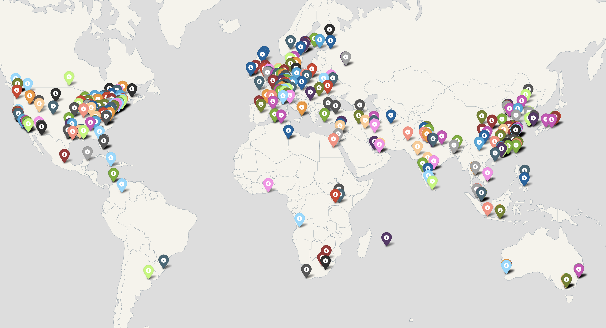

<h1 align="center">
&#127759; <code>CitationMap</code>: 谷歌学术论文引用分布地图
</h1>

<p align="center">
<strong>CitationMap：在世界地图上展示论文引用者的机构分布</strong> [<a href="https://openreview.net/pdf?id=BqJgCgl1IA">PDF</a>]
</p>

<p align="center"><a href="README.md">English</a> | 中文</p>

<div align="center">

[](https://openreview.net/pdf?id=BqJgCgl1IA)
[](https://www.techrxiv.org/users/809001/articles/1213717-citationmap-a-python-tool-to-identify-and-visualize-your-google-scholar-citations-around-the-world)
[](https://twitter.com/ChenLiu_1996)
[](https://www.linkedin.com/in/chenliu1996/)
[](https://scholar.google.com/citations?user=3rDjnykAAAAJ&sortby=pubdate)
<br>
[](https://pypi.org/project/citation-map/)
[](https://pepy.tech/projects/citation-map)
[](https://pypistats.org/packages/citation-map)
[![CC BY-NC-SA 4.0][cc-by-nc-sa-shield]][cc-by-nc-sa]
[![CC BY-NC-SA 4.0][cc-by-nc-sa-image]][cc-by-nc-sa]

[cc-by-nc-sa]: http://creativecommons.org/licenses/by-nc-sa/4.0/
[cc-by-nc-sa-image]: https://licensebuttons.net/l/by-nc-sa/4.0/88x31.png
[cc-by-nc-sa-shield]: https://img.shields.io/badge/License-CC%20BY-NC-SA%204.0-lightgrey.svg

</div>

&#127942; **全球首个免费工具**，将你的谷歌学术引用可视化到世界地图上。

&#11088; **无需 clone 或 fork** 本仓库即可使用，除非你要自定义修改。

&#128640; **一行安装，四行运行**！

&#127760; 使用前请先安装 Chrome 浏览器。遇到验证码时，需要在弹出的浏览器窗口中手动完成验证。

&#128073; 因个人原因，无法再为遇到问题的用户代为运行 CitationMap，敬请谅解。

&#9888;&#65039; 6.0 版已改进验证码处理和中断后的恢复方式，但谷歌学术仍可能限制访问。遇到验证码时，请按终端提示操作。


<br>

我是 [Chen Liu](https://chenliu-1996.github.io/)，耶鲁大学计算机科学博士生。

## 用途

本工具根据你的 [Google Scholar ID](https://scholar.google.com/citations?user=3rDjnykAAAAJ) 生成 HTML 格式的引用世界地图。

安装简单（已上架 [PyPI](https://pypi.org/project/citation-map/)），使用简单（见下方[简明指南](#简明使用指南)或[完整指南](#使用指南)）。

## 简明使用指南

面向熟悉 Python 的用户。若不熟悉，请阅读[使用指南](#使用指南)。

**如果只是使用本工具，无需克隆或 fork 仓库。** 用 pip 安装后，将下面的代码保存为 Python 脚本即可运行。

### &#128640; 一行安装

```
pip install citation-map
```

若要安装最新版：`pip install citation-map --upgrade`。

### &#128640; 四行运行

将下面代码复制到一个空的 `.py` 文件（如 `run.py`），把 Scholar ID 换成你的，然后执行 `python run.py`。

```python3
from citation_map import generate_citation_map

if __name__ == '__main__':
    scholar_id = '3rDjnykAAAAJ'  # 这是我的 Google Scholar ID，请替换成你的。
    generate_citation_map(scholar_id)
```

**请一直保留弹出的 Chrome 窗口，直到程序运行结束。** 程序会在这个窗口中打开需要人工验证的页面。终端提示输入验证码时，请按以下步骤操作：

1. 切换到弹出的 Chrome 窗口，完成验证码验证。
2. **验证完成后不要关闭这个窗口。** 后续查询还会用到它。
3. 回到终端，**按 Enter 键**，让程序继续运行。

如果再次出现验证码，重复以上步骤即可。

## 预期输出

脚本会生成一个 **HTML 文件**。

保持网络连接，用浏览器打开 HTML 文件即可查看地图。你可以缩放、拖动地图，将鼠标移到国家上查看名称，或点击标记查看引用作者及其机构。效果类似下图。



同时会生成一个 **CSV 文件**，记录引用信息（引用作者、引用文献、被引文献、机构、详细位置）。

**说明：** 本工具用于大致了解论文引用者的地域分布，可能遗漏部分作者，也可能将机构标在错误的位置。如果需要逐一核实，可以修改输出的 CSV，或在 [Google My Maps](https://www.google.com/maps/d/) 上手动标注。

**机构识别方式：** 默认使用作者自行填写的机构信息，能找到更多机构，但也更容易误判。将 `affiliation_conservative` 设为 `True` 后，只采用作者主页中链接到谷歌学术机构页面的机构，结果通常更准确，但可能遗漏其他任职单位或未被识别的机构。感谢 [Zhijian Liu](https://github.com/zhijian-liu) 的[建议](https://github.com/ChenLiu-1996/CitationMap/issues/8)。

## 引用

BibTeX
```
@article{citationmap,
  title={CitationMap: A Python Tool to Identify and Visualize Your Google Scholar Citations Around the World},
  author={Liu, Chen},
  journal={Authorea Preprints},
  year={2024},
  publisher={Authorea}
}
```
MLA
```
Liu, Chen. "CitationMap: A Python Tool to Identify and Visualize Your Google Scholar Citations Around the World." Authorea Preprints (2024).
```
APA
```
Liu, C. (2024). CitationMap: A Python Tool to Identify and Visualize Your Google Scholar Citations Around the World. Authorea Preprints.
```
Chicago
```
Liu, Chen. "CitationMap: A Python Tool to Identify and Visualize Your Google Scholar Citations Around the World." Authorea Preprints (2024).
```

## 动态

[2026年11月5日] 6.0 更新 >>> 改进谷歌学术数据获取方式，所有验证码都在同一个 Chrome 窗口中手动处理。机构查询支持并发和中断后继续，机构定位增加缓存、减少重复请求，并修复 Ctrl+C 无法中断的问题。地图改用内置国界数据，避免底图显示访问被拒绝的错误图片；同时修复翻页和无结果时的处理问题。详见[更新日志](#更新日志)。

[2025年10月14日] 5.0 发布 >>> 改进验证码处理。

[2024年8月2日] 4.0 发布 >>> 新增参数 `affiliation_conservative`，可选用更保守的机构识别策略（更高精确率、更低召回率）。感谢 [Zhijian Liu](https://github.com/zhijian-liu) 的[讨论](https://github.com/ChenLiu-1996/CitationMap/issues/8)。

[2024年7月28日] 3.10 发布 >>> 逻辑更新，已在**约 1 万引用**的教授页面上测试通过。

[2024年7月27日] 2.0 发布 >>> 多进程约 10 倍加速（本人 100 引用从约 1 小时降至约 5 分钟）。

[2024年7月26日] 1.0 发布 >>> 首个可运行版本（本人 100 引用）。

## 使用指南

1. **准备 Python 环境并安装。** 如果刚接触 Python，可以先安装 [Anaconda](https://www.anaconda.com/) 等带环境管理功能的发行版。在准备好的 Python 环境中执行：

   ```bash
   pip install citation-map --upgrade
   ```

2. **找到你的 Google Scholar ID。** 打开谷歌学术个人主页。如果地址是 `https://scholar.google.com/citations?user=GOOGLE_SCHOLAR_ID`，那么 `user=` 后面的 `GOOGLE_SCHOLAR_ID` 就是你的 ID。后面的 `&hl=en`、`&sortby=pubdate` 等参数不属于 ID。

3. **保存并运行脚本。** 将下面的代码保存为 `run.py`，替换其中的 Scholar ID，再执行 `python run.py`。不要把脚本命名为 `citation_map.py`，否则会与包名冲突，影响导入。建议保留示例中的 `if __name__ == '__main__':`，让程序只在直接运行脚本时启动。

   ```python3
   from citation_map import generate_citation_map

   if __name__ == '__main__':
       scholar_id = '3rDjnykAAAAJ'  # 替换成你的 Google Scholar ID。
       generate_citation_map(scholar_id)
   ```

4. **按提示完成验证，等待输出。** 遇到验证码时，在弹出的 Chrome 窗口中完成验证，保留窗口，再回到终端按 Enter。程序运行期间不要关闭这个浏览器窗口。运行结束后会生成 HTML 地图和 CSV 明细。

### 机构查询与缓存

默认最多同时发起 8 个 HTTP 机构查询请求，但只使用一个 Chrome 窗口处理需要人工验证的页面。每次请求前仍会等待 1–5 秒。如果 HTTP 查询失败，程序会暂停发起新请求，等已发出的请求结束后，再在浏览器中读取相关页面。后续请求会使用浏览器更新后的 Cookie；如果仍然反复失败，剩余作者会改为逐个在浏览器中查询。设为 `num_processes=1` 可从一开始就使用逐个浏览器查询的方式。

同一作者出现在多篇引用文献中时，会复用已获取的机构信息；完成一位作者的查询后，就会保存进度。如果中途停止，重新运行相同的脚本即可读取已有缓存。保守模式和默认模式分别保存机构缓存，但共用此前获取的引用关系。论文与引用关系的获取、机构定位这两个步骤仍依次进行，不使用并发。

默认缓存目录为 `cache`，机构定位结果保存在 `cache/geocodes_v1.pkl`，不同 Scholar ID 可以复用这些定位结果。设为 `cache_folder=None` 可关闭磁盘缓存。缓存不会自动更新；如果需要重新获取某个作者的数据，可以删除其缓存。清除缓存后，相关查询需要重新进行。

### 手动修改地图

可以先运行一次，得到 CSV 和 HTML，再修改 CSV 中的信息。修改位置时，也需要填写正确的经纬度。之后用下面的方式重新生成地图，无需再次抓取数据或查询坐标：

```python3
generate_citation_map(
    scholar_id,
    csv_output_path='citation_info.csv',
    output_path='citation_map.html',
    parse_csv=True,
)
```

更多示例见 [demo 脚本](https://github.com/ChenLiu-1996/CitationMap/blob/main/demo/demo.py)。

### 参数说明

| 参数 | 默认值 | 说明 |
| --- | --- | --- |
| `scholar_id` | 必填 | 你的 Google Scholar ID。 |
| `output_path` | `'citation_map.html'` | HTML 地图的保存路径。 |
| `csv_output_path` | `'citation_info.csv'` | CSV 明细的保存路径；`parse_csv=True` 时从这里读取。 |
| `parse_csv` | `False` | 设为 `True` 后，直接用已有 CSV 生成地图，跳过数据抓取和机构定位。 |
| `cache_folder` | `'cache'` | 缓存目录；设为 `None` 可关闭磁盘缓存。 |
| `affiliation_conservative` | `False` | 是否采用保守的机构识别方式。 |
| `num_processes` | `8` | 机构查询的最大 HTTP 并发数，不是浏览器窗口数；设为 `1` 后逐个使用浏览器查询。 |
| `pin_colorful` | `True` | 是否使用多种颜色的地图标记。 |
| `print_citing_affiliations` | `True` | 是否在终端打印引用作者及其机构。 |

6.0 版已移除 `use_proxy` 参数。它只对旧版的 `scholarly` 查询有效，不适用于当前的查询方式；旧脚本中如果传入了这个参数，请将其删除。

## 局限

6.0 版改进了人工验证码处理、中断后的进度恢复和机构定位缓存，地图也不再需要在线加载底图图片。不过，以下限制仍然存在。

1. **数据是否完整，取决于谷歌学术。** 如果个人主页未及时更新、引用文献未被收录、引用作者没有可访问的主页或未填写机构，地图就可能遗漏相应信息。机构来自查询时的作者主页，不一定是论文发表时的任职单位。因此，这张地图适合展示引用的大致分布，不能替代完整的历史记录。
2. **人工验证不能保证始终可以访问。** 所有验证码都集中在一个 Chrome 窗口中处理，但谷歌学术仍可能限制访问，页面结构也可能变化。在浏览器中验证成功后，HTTP 请求未必能恢复；程序会在反复失败后改用浏览器逐个读取。如果浏览器也无法读取所需页面，程序会报错停止。并发数越高，越容易触发访问限制；改为逐个查询后，速度也可能较慢。
3. **机构识别可能有误。** 默认模式根据作者自行填写的文字和简单规则提取机构，可能拆错机构名称、保留无关内容，或误删有效信息。保守模式只采用谷歌学术识别出的机构，可能遗漏其他任职单位。部分公司的位置采用预设的总部坐标，不代表作者实际工作的办公室。
4. **机构定位可能不准确或没有结果。** Nominatim 可能找不到机构、返回同名机构的位置，或缺少部分地址信息。定位仍按顺序进行，并限制请求频率；缓存、超时和有限次数的重试能减少重复工作，但首次运行仍可能较慢。无法定位的记录会保留在 CSV 中，经纬度留空，不会在地图上显示。可以手动修正后用 `parse_csv=True` 重新生成地图。
5. **缓存与地图显示也有限制。** 缓存中的机构信息可能过时；查无结果的定位查询也会被缓存，清除后才会重新查询。启用缓存时，已完成的机构查询和定位会保存进度，但引用关系要等整个获取步骤完成后才会保存，中途停止可能需要重新获取。内置底图只显示国界，没有街道细节。地图不再请求在线底图图片，但显示地图所需的 JavaScript 和 CSS 仍从外部网站加载，因此不能完全离线使用。

## 排错

1. **出现验证码，或 HTTP 查询反复失败。** 按终端提示，在同一个 Chrome 窗口中完成验证，保留窗口，再回到终端按 Enter。程序可能自动改为逐个使用浏览器查询。如果仍无法访问，可以停止程序，稍后再试，并设为 `num_processes=1`。启用缓存时，已完成的机构查询和定位结果会被复用。
2. **提示无法读取作者主页、论文列表或引用结果，或翻页时出现重复页面。** 先查看 Chrome 中是否显示访问限制、页面不存在等提示。如果页面看起来正常，但程序仍无法解析，可能是谷歌学术修改了页面结构。提交问题时，请附上报错信息和相关页面链接。程序不会把无法读取的页面当成正常的空结果。
3. **定位较慢，或 CSV 中部分经纬度为空。** 检查机构名称是否正确；可以在 CSV 中直接补充或修改位置。定位期间可以按 Ctrl+C 中断，启用缓存时，重新运行会复用已完成的查询。如果需要重新查询已缓存的“查无结果”记录，可以删除定位缓存文件（默认是 `cache/geocodes_v1.pkl`）后再运行，也可以直接修改 CSV，再用 `parse_csv=True` 生成地图。
4. **旧地图仍显示“访问被拒绝”的底图图片。** 用 6.0 版读取已有 CSV，并设为 `parse_csv=True`，重新生成 HTML 即可。新版地图使用内置的 Natural Earth 国界数据，不再请求在线底图图片。如果整个地图区域都为空白，请检查浏览器是否无法加载外部 JavaScript 或 CSS。

## 更新日志

<details>
<summary>6.0 版（2026年11月5日）</summary>
<br>

1. **改进谷歌学术数据获取和验证码处理。** 所有需要人工处理的验证码都集中在同一个 Chrome 窗口中完成。
2. **机构查询支持并发和中断后继续。** 增加并发查询和缓存，重新运行时可接着已有进度查询。`num_processes` 默认值改为 8。
3. **改进机构定位。** 减少重复请求，增加可复用的位置缓存，并修复 Ctrl+C 无法中断的问题。
4. **更换世界地图底图。** 改用内置的国界数据，避免底图显示访问被拒绝的错误图片。地图仍可缩放、拖动，点击标记即可查看详情。
5. 修复引用结果翻页和无结果时的处理问题，整理代码，并移除已不再使用的 `use_proxy` 参数及 `scholarly` 依赖。

</details>

此前版本的详细记录见英文版 [Changelog](README.md#changelog)：5.0 改进验证码处理；4.5 支持手动修改 CSV 后生成地图；4.0 增加保守机构识别和缓存；3.x 改进性能与处理逻辑；2.0 引入多进程加速；1.0 为首个可运行版本。

## 依赖

通过 pip 安装时，会自动安装所需依赖：`geopy`、`folium`、`tqdm`、`selenium`、`bs4`、`pycountry` 和 `pandas`。

## 致谢

本工具在 ChatGPT-4o 的协助下完成初稿，并经过大量调试。
